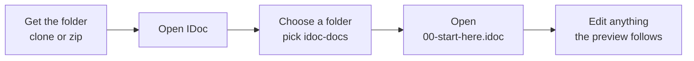

<div align="center">


# IDoc docs

**One hundred and six working documents that show what IDoc can do. Open them, change them, break them.**

[](https://idoc.page)
[](https://github.com/RU-EducationalPlatform/idoc-desktop/releases/latest)
[](#whats-inside)

</div>

---

## What this is

Every file here is a real IDoc document, one topic each. Charts, equations, code that runs, exams that print and grade themselves, slide decks, a whole course file. They are not screenshots or descriptions of features. You open one in IDoc and the examples are live, so you can edit a line and watch the page change.

GitHub cannot show them, because an `.idoc` file is source for the app, not a page. The app is where they come alive.

## Get the documents

Pick whichever is easier. The result is the same folder.

<table>
<tr>
<td width="50%" valign="top">

### Clone it

If you have Git, this keeps you up to date later.

```bash
git clone https://github.com/RU-EducationalPlatform/idoc-docs.git
```

To pick up new demos, run `git pull` inside the folder.

</td>
<td width="50%" valign="top">

### Or download a zip

No Git needed.

1. Click the green **Code** button at the top of this page.
2. Choose **Download ZIP**.
3. Unzip it somewhere you will find again, like your Documents folder.

</td>
</tr>
</table>

## Set it up in IDoc

You need the app first. Use the [desktop app](https://github.com/RU-EducationalPlatform/idoc-desktop/releases/latest) (Mac, Windows or Linux) or open [idoc.page](https://idoc.page) in your browser. The desktop app is the easier of the two for this, because your files stay on your own disk.



1. **Open IDoc** and sign in if it asks.
2. **Choose a folder.** In the workspace picker, choose a folder, then select the `idoc-docs` folder you just downloaded. IDoc treats that folder as your workspace, so every file in it shows up in the file list.
3. **Open `00-start-here.idoc`.** It links to everything else in a sensible reading order, so you never have to hunt.
4. **Change something.** Edit a line in the source on the left and the preview on the right updates. That is the whole idea. If you break something, press undo or run `git checkout .` and you are back to the original.

If you would rather keep the demos untouched, copy the files you like into your own workspace and play with the copies. Each document keeps its helper files in a folder next to it, named like `the-document.assets/`, so copy the folder along with the file.

## Where to start

Follow this order the first time through. It builds up.

| Step | Open | You will learn |
|---|---|---|
| 1 | `write/` | Headings, layout, text, lists, tables, styles |
| 2 | `maths/` | Equations without backslashes, units, chemistry, Lean proofs |
| 3 | `questions/` and `variables/` | Questions that mark themselves, and randomised versions of them |
| 4 | `exams/`, `papers/`, `slides/` | Printable exams, papers with citations, slide decks |
| 5 | `code/` and `octo/` | Code that runs in the page, and the Octo language |
| 6 | `charts/` and `studios/` | Forty-odd chart types, plus the drawing, circuit and music studios |
| 7 | `docent/` | Turning your documents into a course |
| 8 | `accessibility/`, `forms/`, `editor/` | Reading aloud, signing, and the editor itself |

## What's inside

| Folder | Documents | What is in it |
|---|---:|---|
| `write/` | 5 | The basics: structure, layout, text, lists, styles |
| `maths/` | 3 | Equations, units, chemistry and proofs checked in the browser |
| `questions/` | 3 | The question kinds, and how they are graded |
| `variables/` | 6 | Randomised numbers and variants, so every student gets their own |
| `exams/` | 1 | Exams on paper, scanned back in |
| `papers/` | 14 | Front matter, theorems, citations, figures and media |
| `slides/` | 15 | Slide decks and presenting |
| `code/` | 9 | Running, grading and randomising code, notebooks, hardware debugging |
| `octo/` | 20 | The Octo language, from basics to stats and signal work |
| `charts/` | 12 | Bars, maps, 3-D terrain, distributions and every argument a chart takes |
| `studios/` | 12 | Drawing, circuits, music and the other studios |
| `modules/` | 1 | Interactive modules you can drop into a document |
| `docent/` | 1 | A full course file, with a sample course |
| `accessibility/` | 1 | Read-aloud and audio |
| `forms/` | 1 | Signing and forms |
| `editor/` | 1 | Workspaces, collaboration and editor tips |
| `styles/` | 0 | Stylesheets the demos share |

## A few things worth knowing

<details>
<summary><b>Do I need an account?</b></summary>

No. You can open and edit these documents without signing in. An account is only needed for things that live on a server, like handing a course to a class.

</details>

<details>
<summary><b>Will my edits go back to this repository?</b></summary>

No. Your edits stay on your machine. This repository is a mirror that is refreshed automatically from our own copy, so anything pushed directly here gets overwritten. If you have a suggestion, open an issue.

</details>

<details>
<summary><b>Some code examples need an add-on. Where is it?</b></summary>

Python, C, C++, Arduino and the speech features arrive as add-on packs you install from inside the desktop app, so the first download stays small. The code demos will tell you if a pack is missing.

</details>

<details>
<summary><b>I opened a file and it just shows text.</b></summary>

You are probably looking at it in a plain text editor or on GitHub. Open it from inside IDoc instead.

</details>

<details>
<summary><b>I want to start my own document, not read these.</b></summary>

Make a new file ending in `.idoc` in your workspace and begin with `@title(My first document)`. The files in `write/` show what comes next.

</details>

## Keeping up to date

New demos appear here whenever we add them. With a clone, `git pull` gets them. With a zip, download it again and copy over anything you changed first.

---

<div align="center">

Built by [prosAIdon](https://github.com/RU-EducationalPlatform) at Rutgers. &nbsp;·&nbsp; [idoc.page](https://idoc.page) &nbsp;·&nbsp; [Desktop app](https://github.com/RU-EducationalPlatform/idoc-desktop)

</div>
